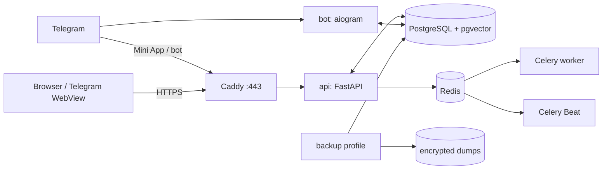

# Деплой и эксплуатация OracleAI

## Document orientation

| Field | Definition |
|---|---|
| **Purpose** | Deployment and release procedure. |
| **Source of truth** | `infra/`, `Makefile`, `.env*.example`, `scripts/`. |
| **Scope** | Docker Compose, environment, migrations, health, observability, backup and rollback. |
| **Do not change** | Do not use dev authentication or real credentials in Git. |
| **Key files** | `infra/docker-compose.yml`, `infra/Dockerfile`, `Makefile`, `scripts/release_gate.py`. |
| **Validation** | `python3 -m scripts.selfcheck && python3 -m scripts.release_gate`. |


## Модель production-развёртывания

Production-like стек собирается Docker Compose из `postgres`, `redis`, `migrate`, `api`, `bot`, `worker`, `beat` и `caddy`. Один общий application image содержит API, Telegram-бота, LLM-agent runtime, астрологический движок, ONNX/MediaPipe palm engines, Mini App, admin и landing. `worker` и `beat` используют тот же image и подключаются к Redis/PostgreSQL.[1]



## Предварительные условия

| Требование | Почему это важно |
|---|---|
| Linux-хост с Docker Engine и Docker Compose v2 | Официальный способ запуска production-стека. |
| Домен с A/AAAA-записью на сервер | Нужен Caddy для автоматического TLS и Telegram Mini App. |
| Открытые TCP-порты 80 и 443 | Нужны HTTP→HTTPS и выдача сертификата. |
| Защищённый доступ к серверу | PostgreSQL, Redis, токены бота и платёжные секреты являются критичными данными. |
| Созданный Telegram-бот | Требуются `BOT_TOKEN`, `BOT_USERNAME`, `WEBAPP_URL`. |
| Резервное хранилище вне сервера | Локальный volume не защищает от потери хоста. |

Не публикуйте FastAPI напрямую на произвольном порту и не задавайте `DEV_MODE=1` в production.

## Конфигурация

Создайте файл `.env` из production-шаблона; он не должен попадать в Git.

```bash
cp .env.production.example .env
chmod 600 .env
```

| Группа | Переменные | Требование production |
|---|---|---|
| Режим и URL | `APP_ENV`, `DEV_MODE`, `WEBAPP_URL`, `RELEASE_ID` | В production `APP_ENV=production`, `DEV_MODE=0`; `WEBAPP_URL` — публичный HTTPS URL без credentials; `RELEASE_ID` — approved commit/tag. При отсутствии обязательных значений API и release gate завершаются fail-closed. |
| Telegram | `BOT_TOKEN`, `ADMIN_ID` | Реальные значения; не логировать и не передавать на клиент. |
| LLM | `LLM_PROVIDER`, `OPENAI_API_KEY`, `ANTHROPIC_API_KEY`, `CUSTOM_*` | Достаточно ключа выбранного провайдера; offline fallback остаётся аварийным режимом. |
| Платежи | `PADDLE_API_KEY`, `PADDLE_API_URL`, `PADDLE_CHECKOUT_URL`, `PADDLE_PRICE_IDS`, `PADDLE_WEBHOOK_SECRET` | Нужны вместе при включении web checkout; `PADDLE_PRICE_IDS` связывает внутренние планы с `pri_...` на сервере. |
| Наблюдаемость | `SENTRY_DSN`, `LOG_LEVEL`, `RELEASE_ID`, `LOG_FILE` | JSONL logs идут в stdout; `LOG_FILE` опционален и должен быть writable. Sentry — опционально, но рекомендован для production. |
| Резервное копирование | `BACKUP_ENCRYPTION_KEY_HOST_PATH`, `BACKUP_STORAGE_PATH`, `BACKUP_REQUIRE_ENCRYPTION`, `BACKUP_REQUIRE_OFFSITE`, `BACKUP_KEEP`, `BACKUP_S3_*` | Профиль `backup` требует отдельный host key, host-mounted storage, encrypted PostgreSQL dump, checksum, retention и restore drill. При `BACKUP_REQUIRE_OFFSITE=1` S3-compatible credentials и bucket обязательны. BUS-833: на OCI VPS offsite отложен (карточка 4ac3cd86, ответ «later») — `BACKUP_REQUIRE_OFFSITE=0` задаётся OVERRIDE-ом в `infra/docker-compose.oci.yml`, шаблон `.env.production.example` сохраняет полный контракт =1. |
| Хранилище/очередь | `DATABASE_URL`, `POSTGRES_PASSWORD`, `REDIS_URL`, `CELERY_ENABLED` | Production требует PostgreSQL URL, непустой непредсказуемый пароль и Redis URL при включённом Celery; шаблонные значения (`oracle`, `CHANGE_ME`, `password`, `postgres`) блокируются.

Конфигурация читается dataclass-настройками в `app/config.py`; неизвестные или небезопасные значения не следует «исправлять» прямо в контейнере.[2]

## Первый релиз

1. На сервере получите репозиторий из проверенного remote и перейдите на нужный commit/тег.
2. Заполните `.env`, настройте `infra/Caddyfile` на фактический домен и проверьте DNS.
3. Соберите и поднимите стек.
4. Проверьте health endpoint и основные пользовательские пути.
5. После успешной проверки настройте Telegram Mini App URL и webhook согласно выбранному режиму бота.

## Публичный URL (BUS-1529)

Канонический production-хост — **`app.primebond.bond`**. Он резолвится и отдаёт 200 через наш Caddy (`via: 1.1 Caddy`, заголовки из `infra/Caddyfile`):

```bash
curl -fsS https://app.primebond.bond/            # 200
curl -fsS https://app.primebond.bond/api/health  # {"ok":true}
```

`DOMAIN` в `.env` **не нужно менять** — Caddy берёт его из `env_file: ../.env` и по умолчанию `${DOMAIN:-localhost}`; на VPS-проде значение `DOMAIN` не задан, но публичный хост уже работает через Cloudflare → Caddy. Не перепутайте его с `oracleai.trycloudflare.com`:

- `oracleai.trycloudflare.com` — **не резолвится** (`getent` пусто, curl HTTP 000). Это quick-tunnel hostname, который не настроен и не документирован. Не используйте его как production URL.
- `*.trycloudflare.com` — легитимны **только для staging** (`infra/staging/staging-public-tunnel.sh`, `PUBLIC_URL.txt`). Staging URL меняется при каждом рестарте туннеля; production Quick Tunnel не даёт стабильный hostname.

`WEBAPP_URL` и `PUBLIC_URL` задаются отдельно — это URL, которые бот вставляет в клавиатуру «Открыть Оракула» и которые используются gate'ами.

### Caddy access log

До BUS-1529 Caddy не вёл `access_log` — весь публичный трафик был не наблюдаем (0 строк за 30 дней). Лог пишется в `infra/Caddyfile`:

```caddyfile
log {
    output file /var/log/oracleai/caddy-access.log
}
```

Том `oracle_logs` монтируется в `infra/docker-compose.yml:187` (`oracle_logs:/var/log/oracleai:rw`) — тот же том, что и у остальных сервисов, с ротацией `json-file`-драйвера. Проверка:

```bash
curl -fsS https://app.primebond.bond/api/health >/dev/null
docker compose -p infra exec caddy sh -c 'tail -n 5 /var/log/oracleai/caddy-access.log'
```

```bash
cd /srv/oracleAI
git fetch --all --tags
git checkout <approved-commit-or-tag>
# BUS-833: VPS-прод поднимается С УЧЁТОМ OCI-оверрайда. `docker-compose.oci.yml`
# задаёт `BACKUP_REQUIRE_OFFSITE: "0"` для профиля `backup` (offsite D4 отложен,
# карточка 4ac3cd86). Без `-f infra/docker-compose.oci.yml` стек поднимется по
# `.env.production.example`, где `BACKUP_REQUIRE_OFFSITE=1` и без S3-обвязки
# `backup-postgres.sh:32` упадёт с exit 1 → бэкап-цикл мёртв, алерты мёртвы.
# То же самое, если репо откатится на коммит до 4b45cf6 — оверрайд пропадёт.
docker compose -p infra \
  -f infra/docker-compose.yml -f infra/docker-compose.oci.yml \
  --env-file ../.env \
  build --pull
docker compose -p infra \
  -f infra/docker-compose.yml -f infra/docker-compose.oci.yml \
  --env-file ../.env \
  up -d --remove-orphans
docker compose -p infra \
  -f infra/docker-compose.yml -f infra/docker-compose.oci.yml \
  --env-file ../.env \
  ps
curl --fail --silent --show-error https://YOUR_DOMAIN/api/health
```

### Проверка соответствия running container ↔ репо (BUS-833)

После каждого деплоя проверяйте, что оверрайд в репо совпадает с тем, что применился в контейнере. Иначе следующий `prod-stack-up.sh` (автозапуск после ребута, BUS-440) может поднять стек без оверрайда, и бэкап-цикл упадёт без предупреждения:

```bash
# 1. В репо (на commit, на который перешёл checkout):
grep -n 'BACKUP_REQUIRE_OFFSITE' infra/docker-compose.oci.yml
# ожидание: строка 74  →  BACKUP_REQUIRE_OFFSITE: "0"

# 2. В running container:
docker compose -p infra \
  -f infra/docker-compose.yml -f infra/docker-compose.oci.yml \
  --env-file ../.env \
  config | grep -A30 'services:\n  backup' | grep -A3 BACKUP_REQUIRE_OFFSITE
# ожидание: BACKUP_REQUIRE_OFFSITE=0

# 3. Самый свежий дамп должен быть локальным (без offsite), но существовать:
ls -t /srv/oracle/backups/*.dump.enc 2>/dev/null | head -1
```

Если п.1 или п.2 покажет `1` — **остановите деплой и эскалируйте DevOps**: оверрайд не применился, и `backup-postgres.sh:32` отвергнет цикл. Контрольная точка: `infra/docker-compose.oci.yml:74` и `infra/prod-stack-up.sh:27-31` (COMPOSE_ARGS включает OCI-файл явно).

Минимальный smoke test включает: успешный `migrate`, `GET /api/health` с ответом `{"ok":true}`, `celery -A app.queue:celery_app inspect ping`, открытие русского и английского лендинга, запуск Mini App из Telegram, смену языка, выключение/включение памяти и один ответ проводника. Для web checkout сначала создайте Paddle transaction через серверный API и проверьте sandbox webhook только по `transaction.completed`; не подставляйте `tg_id` или тариф вручную в hosted URL.

## Обновление версии

> Перед обновлением обязательна подтверждённая резервная копия PostgreSQL. Dump создаётся профилем `backup`; не копируйте файлы тома PostgreSQL во время записи.

```bash
cd /srv/oracleAI
docker compose --profile backup -f infra/docker-compose.yml up -d backup
git fetch --all --tags
git checkout <approved-commit-or-tag>
# 1) Обновить RELEASE_ID в .env ДО сборки — иначе bake зафиксирует старый sha в контейнерах
sed -i "s/^RELEASE_ID=.*/RELEASE_ID=$(git rev-parse --short HEAD)/" .env
# 2) Собрать ВСЕ build-сервисы compose (api, bot, worker, beat, migrate) — селективный перекат оставляет beat/бота на старом образе
docker compose -f infra/docker-compose.yml build --pull api bot worker beat migrate
docker compose -f infra/docker-compose.yml up -d
# ⛔ Selfcheck ТОЛЬКО на _test-базе или APP_ENV=dev. Против прода selfcheck
# НЕ запускается: его _truncate_all очищает базу между секциями, 08.09 это
# уничтожило прод-БД (incident BUS-660). Гард BUS-709 откажет при попытке
# (RuntimeError «TRUNCATE на проду запрещён»), а проверка «Прод-грант»
# в наборе selfcheck подтверждает грант без TRUNCATE у app-роли.
# Прод-selfcheck (health без DDL) делают read-only путями: /api/health,
# verify-deploy.sh и smoke через smoke-id 999000000+ (BUS-315/BUS-385).
# Запуск на ДЕПОЙ-СТЕНДЕ (test-база): env подменяется ВНУТРИ контейнера
# флагами exec (-e), env-префикс shell до compose контейнеру не передаётся.
# TEST_DATABASE_URL — как в Makefile (_test): oracle_test @ postgres:5432.
docker compose -f infra/docker-compose.yml exec \
  -e APP_ENV=test -e ALLOW_DB_RESET=1 \
  -e DATABASE_URL="postgresql+asyncpg://oracle_test:$(grep '^POSTGRES_PASSWORD=' .env | cut -d= -f2-)@postgres:5432/oracle_test" \
  api python -m scripts.selfcheck
# После подтверждения ключей провайдера повторить с внешним smoke-test:
# docker compose -f infra/docker-compose.yml exec -e APP_ENV=test -e ALLOW_DB_RESET=1 \
#   -e DATABASE_URL="postgresql+asyncpg://oracle_test:$(grep '^POSTGRES_PASSWORD=' .env | cut -d= -f2-)@postgres:5432/oracle_test" \
#   -e SELF_CHECK_LIVE=1 api python -m scripts.selfcheck
docker compose -f infra/docker-compose.yml logs --tail=100 api bot worker beat
curl --fail --silent --show-error https://YOUR_DOMAIN/api/health
# 3) Верификация деплоя (anti-recidive BUS-194/350/373)
bash infra/verify-deploy.sh $(git rev-parse --short HEAD) --symbol '<служебная_строка_из_дельты_коммита>'
```

## Compose-оверрайды (VPS-специфика) и проверка соответствия

На VPS (`deploy@130.162.245.223`, BUS-704) прод-стек запускается с OCI-оверрайдом
`infra/docker-compose.oci.yml`. Он задаёт VPS-специфику, которую нет в общем
`infra/docker-compose.yml` (ПК-стек):

- `node-exporter` — монтирует `/var/lib/oracleai/textfile` вместо ПК-пути
  `engineering-platform`, без которого бэкап-метрики BUS-833 не скрейпятся.
- `prometheus` — сеть `oracle_internal`, `extra_hosts: []` (ПК-специфика BUS-270).
- `backup` — профиль `backup`, VPS-пути `/srv/oracle/backups` и
  `/etc/oracle/backup.key`, OVERRIDE `BACKUP_REQUIRE_OFFSITE=0` (BUS-833, D4
  отложен карточкой 4ac3cd86).
- `api`/`bot`/`worker`/`beat` — `extra_hosts host.docker.internal:host-gateway`
  для LLM-канала (BUS-1528).

**Правило: оверрайд применяется только если depoy-скрипт подключает `-f`
оверрайда.** Compose merge-ует files в порядке передачи, и
`environment:` в оверрайде перекрывает `env_file: ../.env` — но если `-f`
отсутствует, оверрайд мёртв, а прод берёт значения из `.env`. Источник
истины — `docker compose config`, а не `.env` и не `docker inspect` (BUS-1520:
`docker inspect` env и `compose config` не всегда сходятся).

### Канонический recipe: как поднять прод с оверрайдом

**Однозначный способ:** `docker compose ... -f infra/docker-compose.yml -f infra/docker-compose.oci.yml`.
`-f` передаётся **дважды, в виде массива**, иначе `"-f a.yml -f b.yml"` уходит в один
аргумент и compose распарсит его как путь к одному файлу (BUS-1534).

```bash
# Канонический прод — VPS. prod-stack-up.sh уже подключает оверрайд,
# но при ручном подъёме укажите оба -f явно:
docker compose -p infra \
  -f infra/docker-compose.yml -f infra/docker-compose.oci.yml \
  --env-file .env --profile backup \
  up -d --build --remove-orphans
```

### Проверка соответствия running container vs репо

После любого деплоя (особенно если оверрайд или `.env` менялись) — проверить,
что **running** контейнер имеет значения из оверрайда, а не из `.env`:

```bash
# 1) Статика: compose-файлы резолвят ожидаемые значения независимо от .env
python3 scripts/check_compose_overrides.py
# 2) Живая проверка: running контейнер совпадает с резолвом compose
docker inspect --format '{{range .Config.Env}}{{println .}}{{end}}' infra-backup-1 \
  | grep -E 'BACKUP_REQUIRE_OFFSITE|BACKUP_S3_URL|BACKUP_S3_ACCESS_KEY|BACKUP_S3_SECRET_KEY|BACKUP_S3_BUCKET'
# Ожидание: BACKUP_REQUIRE_OFFSITE=0, S3-переменные пустые.
```

`scripts/check_compose_overrides.py` проверяет шесть пройти (код возврата:
`0` — все пройдены, `1` — есть FAIL; две проверки опциональны и пропускаются
по умолчанию, см. ниже):

- **static** — `docker compose -f ... -f ... --profile backup config` резолвит
  `BACKUP_REQUIRE_OFFSITE: "0"` и пустые S3-переменные в сервисе `backup`
  (независимо от `.env`, placeholder-файл генерируется из
  `.env.production.example` на время проверки).
- **live** — `docker inspect infra-backup-1` имеет те же значения.
  **Опционально** (`CHECK_LIVE=1`): проверяет running-контейнер, которого нет на
  dev-стеке; fail-closed — отсутствие контейнера = FAIL, пропуск без флага =
  PASS.
- **wiring** — `infra/prod-stack-up.sh` и `.github/workflows/deploy.yml`
  оба подключают `-f infra/docker-compose.oci.yml`.
- **env** — VPS `.env` не дублирует оверрайд-переменные. Источник истины —
  compose; `.env` может содержать `BACKUP_REQUIRE_OFFSITE=1` для ПК-стека с
  MinIO, но на VPS дублирование запрещено (BUS-1534 §3).
  **Опционально** (`CHECK_ENV=1`): по умолчанию пропускается, чтобы не мешать
  локальному `.env` разработчика.
- **repo-file** — checkout содержит `infra/docker-compose.oci.yml` с
  `BACKUP_REQUIRE_OFFSITE: "0"` (независимо от того, куда указывает HEAD).
- **repo-sync** — `git rev-parse HEAD` является ancestor'ом `dev` или `master`.
  Detached-HEAD на коммит, который не лежит ни на одной из веток (VPS 2026-10-09
  был на 9023cd1, ancestor'ом neither), — drift: checkout жив, но устарел, и
  следующий `prod-stack-up.sh` может поднять стек без оверрайда → прод
  вернётся к =1 без S3/R2.

### VPS-репо и detached-HEAD (BUS-1534 §1)

На VPS (`/opt/oracleAI`) репо должно быть привязано к `oracleAI/dev` и
переходить на одобренный commit/тег при деплое. Detached-HEAD на старый commit
намеренный только если он подтверждён и совместим со схемой; иначе — drift.

**Проверка, что оверрайд есть в checkout'е (независимо от того, куда указывает HEAD):**

```bash
# 1) HEAD репо совпадает с одобренным commit/тегом
git rev-parse HEAD
git cat-file -t 4b45cf666d5f643f0705c4a60ce3e62a8006eeee
# ожидание: commit (если object не найден — checkout старше фикса BUS-833)

# 2) Оверрайд-файл присутствует и содержит оверрайд
grep -n 'BACKUP_REQUIRE_OFFSITE' infra/docker-compose.oci.yml
# ожидание: строка 74  →  BACKUP_REQUIRE_OFFSITE: "0"

# 3) Резолв compose на checkout'е (без .env-дублирования):
python3 scripts/check_compose_overrides.py
```

Если п.1 или п.2 покажет отсутствие — **остановите деплой и эскалируйте DevOps**:
checkout устарел, и `prod-stack-up.sh` поднимет стек без оверрайда →
`backup-postgres.sh:32` отвергнет цикл. Контрольная точка:
`infra/docker-compose.oci.yml:74` и `infra/prod-stack-up.sh:38`
(`COMPOSE_ARGS` включает OCI-файл явно).

**Критические правила при обновлении:**

1. **Перекат всех build-сервисов обязателен.** `docker compose build api bot worker beat migrate` — не «только api». Beat собирается из того же `infra/Dockerfile`, но тегируются отдельно (`infra-beat:latest`); при избирательном перекате он молча остаётся на старом образе и шлёт задачи Celery по старому расписанию (BUS-373).
2. **Обновлять `RELEASE_ID` в `.env` до сборки.** Compose запекает `env_file` в контейнер на момент создания; если обновить `.env` после сборки — старый sha останется в запущенных контейнерах (дрейф bakery vs build).
3. **Grep-проба символа коммита.** В аргументе `--symbol` передаётся строковый символ из дельты целевого коммита (не хеш!), и скрипт проверяет её присутствие в `/opt/oracle` каждого app-контейнера. Если дельта деплоя затрагивает `app/` — проба обязательна.
4. **Верификация — часть деплоя, не опциональный follow-up.** `verify-deploy.sh` проверяет: все build-контейнеры пересозданы после коммита, `RELEASE_ID` совпадает с целевым sha, образы собраны после коммита (нет recreate без rebuild), контейнеры единого образа не расходятся по SHA, контейнеры общего Dockerfile свежи. См. раздел «Верификация деплоя» ниже.
5. **Не удаляйте старые Docker images до успешной верификации** — встроенный rollback опирается на предыдущий checkout и локальные build layers.

## Верификация деплоя

Скрипт `infra/verify-deploy.sh` — обязательный шаг после любого переката. Он выводит список проверяемых контейнеров из `docker compose config --services` и оставляет только те, у которых есть `build:` в compose (прод: `api`, `bot`, `worker`, `beat`, `migrate`; staging: все app-сервисы). Профильные и одноразовые сервисы (`backup`, `migrate`) исключаются автоматически.

```bash
bash infra/verify-deploy.sh <target-sha> \
  --symbol '<служебная_строка_из_дельты_коммита>'
```

Для staging укажите проект явно:

```bash
bash infra/verify-deploy.sh a6aa63d \
  --project oracleai-staging \
  --symbol '<служебная_строка_из_дельты_коммита>' \
  --env-file infra/staging/.env.staging
```

Коды возврата: `0` — все пробы зелёные, `1` — есть FAIL (детали в выводе), `2` — ошибка использования.

Структура прoверок:
- **P1** — каждый проверяемый контейнер создан после даты коммита (контейнер реально пересоздан в этом деплое).
- **P2** — `RELEASE_ID` внутри каждого контейнера совпадает с целевым sha (детект дрейфа env).
- **P3** — content-проба: строковый символ из дельты коммита найден в `/opt/oracle` каждого контейнера (`--symbol`); `--absent SYM` — негативная проба (символ новее target отсутствует).
- **P4** — контейнеры с одинаковым тегом образа имеют одинаковый resolved SHA.
- **P5** — `CreatedAt` образа каждого контейнера >= даты коммита (детект «recreate без rebuild»).
- **P6** — контейнеры, собираемые из одного Dockerfile, при единой сборке имеют одинаковый resolved SHA (информационно; при `docker compose build` по-сервисно расхождение ожидаемо — свежесть кода проверяют P5/P3).

После изменения фронтенда проверьте версии cache-busting в `miniapp/index.html` и `miniapp/styles.css`; Telegram WebView может держать старые ассеты дольше обычного браузера.[3]

## Миграции и хранилище

В Docker Compose production-like режим использует PostgreSQL + pgvector. Сервис `migrate` выполняет `alembic upgrade head` и должен завершиться успешно до запуска API, бота, worker и Beat. Runtime также выполняет идемпотентный bootstrap для свежей базы. Не выполняйте ручные `ALTER TABLE` в production без кода миграции и резервной копии.[4]

`DATABASE_URL` обязателен во всех окружениях; SQLite/WAL fallback удалён. `connect()` в `app/data/session.py` читает только `DATABASE_URL` (PostgreSQL) и не использует `DB_PATH`. Ручной dev/test-запуск требует поднятого PostgreSQL и корректного `DATABASE_URL`, например через `make test` или Compose.

| Операция | Допустимый подход | Недопустимый подход |
|---|---|---|
| Новая таблица | Добавить DDL в schema, тестировать чистую БД. | Создать таблицу вручную только на production-сервере. |
| Новая колонка | Добавить reconcile-миграцию и совместимый fallback. | Полагаться на `CREATE TABLE IF NOT EXISTS`. |
| Изменение данных | Идемпотентный скрипт + backup + проверка количества строк. | Массовый UPDATE из shell без rollback-плана. |
| Откат кода | Вернуть образ/commit, совместимый с текущей схемой. | Откатить БД «на глаз» без протестированной процедуры. |

## Резервное копирование и восстановление

Профиль `backup` создаёт проверяемый custom-format `pg_dump`, шифрует его AES-256-CBC через host key, сохраняет SHA-256 checksum и применяет retention. При `BACKUP_REQUIRE_OFFSITE=1` он также обязан загрузить dump и checksum в S3-compatible storage; при отсутствии off-site подтверждения job не считает backup успешным.

```bash
install -d -m 700 /etc/oracle /srv/oracle/backups
openssl rand -base64 48 > /etc/oracle/backup.key
chmod 600 /etc/oracle/backup.key
# Заполни BACKUP_S3_URL/ACCESS_KEY/SECRET_KEY/BUCKET в .env;
# production template требует BACKUP_REQUIRE_OFFSITE=1.
docker compose --profile backup -f infra/docker-compose.yml up -d --build backup
```

| Контроль | Минимум |
|---|---|
| Частота | Не реже одного раза в сутки; до релиза — отдельная backup. |
| Хранение | Несколько точек восстановления вне единственного production-хоста. |
| Защита | Шифрование внешнего хранилища, ограниченный доступ, audit доступа. |
| Проверка | Периодически восстановить в изолированном контуре и выполнить `selfcheck`. |
| RPO/RTO | Зафиксировать владельцем продукта до публичного запуска. |

Процедура восстановления PostgreSQL по умолчанию выполняется в свежую изолированную базу. Сначала сохраните текущий кластер как forensic-копию, проверьте checksum, расшифруйте dump во временный файл и восстановите его через helper. Writer-сервисы останавливаются только для явно подтверждённого in-place restore. После восстановления выполните schema/integrity/owner-isolation checks, затем миграцию и только после этого подключайте приложение.

```bash
# Изолированный restore; source database не останавливается.
RESTORE_TARGET_DB=oracle_restore \
  BACKUP_ENCRYPTION_KEY_FILE=/etc/oracle/backup.key \
  ./infra/restore-postgres.sh /srv/oracle/backups/oracle-<дата>.dump.enc

make migrate
make selfcheck
```

Для аварийного in-place restore требуются оба явных флага: `RESTORE_IN_PLACE=1` и `RESTORE_CONFIRM=I_UNDERSTAND_IN_PLACE_RESTORE`; без них helper завершится с отказом. `infra/restore-postgres.sh` проверяет checksum, расшифровывает dump во временный файл, создаёт isolated target DB и передаёт custom-format dump в `pg_restore --clean --if-exists`. Это единственный поддерживаемый путь; SQLite fallback и `scripts/restore_db.sh` удалены.

## Наблюдаемость и инциденты

| Сигнал | Источник | Первое действие |
|---|---|---|
| `/api/health` не `ok` | Health endpoint / Docker healthcheck | Проверить `api` logs, доступ к томам и свободное место. |
| Ошибки 5xx / latency | JSONL API logs, `X-Request-ID`, `X-Response-Time`, Sentry | Запустить `python -m scripts.ops_alerts --log-file <jsonl>` и сопоставить с release/provider/БД. |
| LLM fallback rate | JSONL `llm_request`/`llm_fallback` + `llm_usage` | Проверить provider health, queue, prompt/model release и offline safety; не удалять данные. |
| Не проходят платежи | JSONL `webhook_failure`, webhook logs, provider dashboard | Проверить подпись и sandbox/production-окружение; не повторять начисление вручную без idempotency. |
| Подозрение на утечку | Audit/logs, обращение support | Ограничить доступ, сохранить логи, следовать SECURITY. |

## Откат

Откат возможен только к commit, совместимому с текущей схемой. Сначала возвращайте приложение, затем убеждайтесь, что `/api/health` зелёный и пользовательские операции работают. Если изменение было разрушительным для данных, применяйте заранее проверенный restore из backup вместо произвольного ручного изменения базы.

## Мониторинг и логирование всех контейнеров

Compose включает observability-контур по умолчанию: `Loki` хранит JSON-логи Docker, `Alloy` читает логи всех контейнеров через read-only Docker socket и отправляет их в Loki, `cAdvisor` собирает CPU/RAM/network metrics контейнеров, `node-exporter` — метрики VPS, `Prometheus` хранит time series и alert rules, а `Grafana` автоматически получает оба datasource и готовый dashboard. Promtail намеренно не используется: Grafana объявила его EOL с 2 марта 2026 года и перенесла дальнейшее развитие в Alloy.[5]

```bash
# первый запуск
cp .env.production.example .env
chmod 600 .env
# обязательно заменить GRAFANA_ADMIN_PASSWORD и остальные CHANGE_ME значения
docker compose -f infra/docker-compose.yml up -d --build

docker compose -f infra/docker-compose.yml ps
```

Grafana по умолчанию слушает только `127.0.0.1:3000`, а Prometheus/Loki вообще не публикуются наружу. Для безопасного доступа с рабочей станции используйте SSH-туннель:

```bash
ssh -N -L 3000:127.0.0.1:3000 user@YOUR_VPS
# открыть http://127.0.0.1:3000
```

В Grafana откройте dashboard `OracleAI / OracleAI - Containers & Logs`. Для поиска логов используйте LogQL `{stack="oracleai"}` или фильтр `compose_service="api"`. Для Prometheus доступны alert rules по недоступности targets, частым рестартам, памяти контейнеров и свободному месту root filesystem. Локальные Docker `json-file` logs также ограничены `10m × 5` на контейнер; это защита от заполнения диска, а Loki хранит данные по умолчанию 7 дней.

Docker socket даёт Alloy и cAdvisor доступ к metadata и runtime statistics Docker-хоста, поэтому эти сервисы должны оставаться во внутренней сети и не получать публичные ports. На production VPS регулярно проверяйте размер volumes `loki_data`, `prometheus_data`, `grafana_data` и свободное место диска.

## Автоматический деплой через GitHub Actions

Workflow `.github/workflows/deploy.yml` запускается после push в `master` или вручную через `workflow_dispatch`. Он сначала проверяет Compose definition, затем подключается к VPS по SSH, получает точный `github.sha`, переключает checkout на этот commit, выполняет `docker compose pull` и `docker compose up -d --build --remove-orphans`, ждёт `/api/health` и печатает состояние сервисов. При ошибке workflow пытается вернуть предыдущий commit и поднять его обратно. Деплои сериализованы через GitHub concurrency, поэтому два rollout не выполняются одновременно.[6]

На VPS один раз подготовьте каталог и production env:

```bash
sudo install -d -o deploy -g deploy -m 755 /opt/oracleAI
# Репо приватное: клонирование/fetch только по SSH через read-only deploy key
# (GitHub → Settings → Deploy keys, read-only). Ключ на VPS:
sudo -u deploy ssh-keygen -t ed25519 -f ~deploy/.ssh/github_repo_ed25519 -N '' -C oracleai-vps-repo-ro
# публичный ключ добавить в GitHub deploy keys, затем:
sudo -u deploy bash -c 'printf "Host github.com\n  IdentityFile ~/.ssh/github_repo_ed25519\n  IdentitiesOnly yes\n" > ~/.ssh/config && chmod 600 ~/.ssh/config'
sudo ssh-keyscan -t ed25519,ecdsa,rsa github.com | sudo tee ~deploy/.ssh/known_hosts >/dev/null
sudo -u deploy git clone git@github.com:mdmominakhan60-blip/oracleAI.git /opt/oracleAI
cp .env.production.example .env
chmod 600 .env
# заполнить .env реальными credentials и доменом
sudo install -d -m 700 /etc/oracle
openssl rand -base64 48 | sudo tee /etc/oracle/backup.key >/dev/null
sudo chmod 600 /etc/oracle/backup.key
docker compose -f infra/docker-compose.yml config
docker compose -f infra/docker-compose.yml up -d --build
```

Создайте в GitHub Settings → Secrets and variables → Actions следующие secrets. `VPS_KNOWN_HOSTS` должен содержать заранее проверенный результат `ssh-keyscan -H YOUR_VPS`; workflow не принимает host key автоматически, чтобы не скрывать MITM-риск.[6]

| Secret/variable | Значение |
|---|---|
| `VPS_HOST` | DNS-имя или IP VPS |
| `VPS_USER` | Непривилегированный deploy user, например `deploy` |
| `VPS_SSH_KEY` | Отдельный private deploy key без passphrase в runner; public key добавляется в `~deploy/.ssh/authorized_keys` |
| `VPS_KNOWN_HOSTS` | Проверенный host key из `ssh-keyscan -H` |
| Repository variable `VPS_APP_DIR` | Обычно `/opt/oracleAI` |
| Repository variable `VPS_SSH_PORT` | Обычно `22` |

Workflow клонирует/обновляет checkout на VPS по SSH (`git@github.com:...`) через read-only deploy key, установленный на VPS и добавленный в GitHub → Deploy keys; https-клон приватного репо без auth из workflow невозможен.

Workflow не передаёт production `.env` через GitHub Actions и не хранит credentials в GitHub repository. `.env` создаётся и поддерживается только на VPS. Для SSH-ключа используйте отдельного пользователя без общего root login; дайте ему только необходимые права Docker, каталог проекта и backup path. GitHub рекомендует хранить sensitive values в secrets и не передавать их в командной строке без необходимости.[6]

После добавления secrets выполните сначала ручной `workflow_dispatch`, проверьте dashboard и `/api/health`, затем используйте push в `master` как production trigger. Не удаляйте старые Docker images до успешного health-check: встроенный rollback опирается на предыдущий checkout и доступные локальные build layers.

## References

[1]: [infra/docker-compose.yml](../infra/docker-compose.yml), [infra/Caddyfile](../infra/Caddyfile) и [infra/backup-postgres.sh](../infra/backup-postgres.sh) — состав runtime-стека, TLS и backup.
[2]: [app/config.py](../app/config.py), [.env.production.example](../.env.production.example) — типизированная конфигурация и production-шаблон.
[3]: [miniapp/index.html](../miniapp/index.html) и [miniapp/styles.css](../miniapp/styles.css) — подключение versioned клиентских ассетов.
[4]: [alembic/versions/0001_pg_baseline.py](../alembic/versions/0001_pg_baseline.py), [alembic/versions/0002_task_jobs.py](../alembic/versions/0002_task_jobs.py) и [alembic/versions/0003_widen_tg_id_to_bigint.py](../alembic/versions/0003_widen_tg_id_to_bigint.py) — порядок и правила миграций (`make migrate` = `alembic upgrade head`).
[5]: [Grafana Promtail EOL notice](https://grafana.com/docs/loki/latest/send-data/promtail/) и [Grafana Alloy Docker monitoring](https://grafana.com/docs/alloy/latest/monitor/monitor-docker-containers/) — актуальная схема сбора Docker logs/metrics.
[6]: [GitHub Actions secrets](https://docs.github.com/en/actions/security-for-github-actions/security-guides/using-secrets-in-github-actions) — правила хранения и использования deployment secrets.
